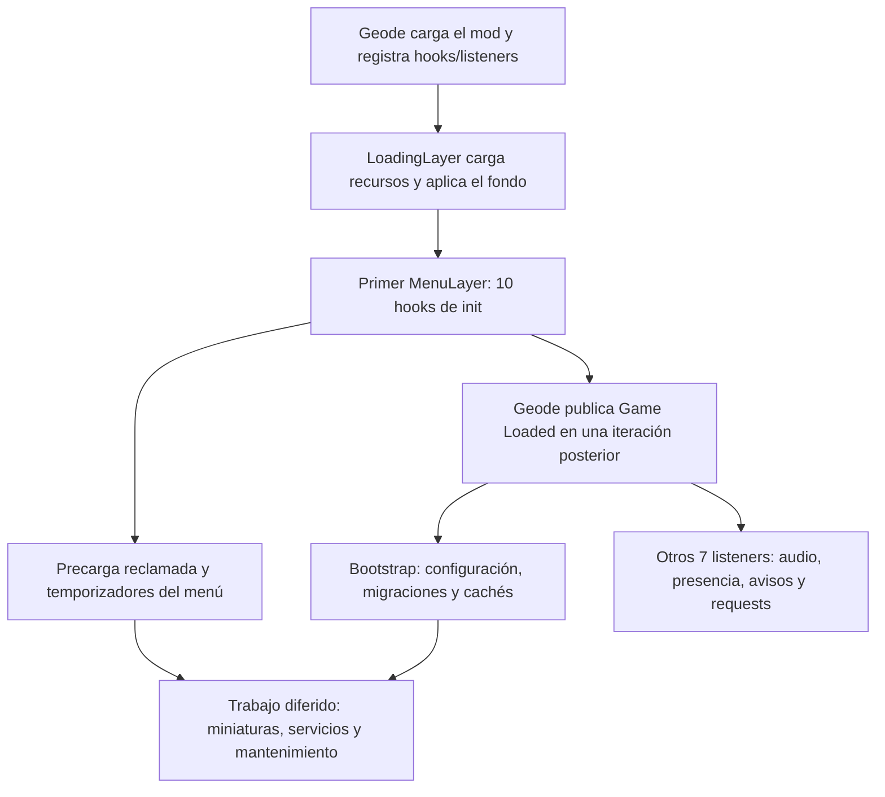

# Auditoría del arranque de Paimbnails — 30/10/2026

El arranque tiene una base razonable, pero todavía mezcla preparación del estado,
migraciones de archivos, restauración visual y trabajo especulativo. Las primeras
correcciones deberían ser el acceso a Geode desde workers y las lecturas de disco
que bloquean consultas del hilo principal mediante mutexes. Después conviene
retirar las copias de archivos y los escaneos innecesarios del primer menú.

Durante la auditoría inicial no se modificó código de producción ni se compiló,
empaquetó o instaló el mod. Las secciones de hallazgos y sus pruebas temporales
describen ese estado inicial.

**Corrección posterior del proveedor de previews:** se eliminó el préstamo del
delegado global. [LevelDataProvider](../src/features/auto-preview/services/LevelDataProvider.cpp)
ahora realiza una petición propia, identifica las respuestas con un token,
resuelve los errores al recibirlos y usa el parser nativo para construir el
nivel. Conserva los límites de tamaño y descarta respuestas antiguas, incluso
si una nueva solicitud corresponde al mismo ID. El cierre libera su callback
antes de desmontar Cocos.

La [cola de previews](../src/features/auto-preview/services/AutoPreviewQueue.cpp)
conserva los candidatos mientras el proveedor está ocupado y comprueba que la
generación siga activada al recibir la descarga. Las fixtures
`auto_preview_late_response` y `auto_preview_queue_request` extraen el código
actual y comprueban estos comportamientos con ASan/UBSan. Los demás hallazgos
del arranque mantienen el estado descrito en esta auditoría.

La corrección se compiló en Release con Geode 5.11.2 mediante el target
`Paimbnails_PACKAGE`, con despliegue local activado. Pasaron las dos fixtures de
previews y `official_slot_download_cache` con ASan/UBSan. El paquete generado
y el instalado coincidieron en SHA-256:
`A53FF92FE7E9B671D509DF03C82373E711A1675A3AD689D099C5515DFF9F57AD`.
No se ejecutó una prueba dentro del juego.

## Alcance y evidencia

- Inventario de 1.532 archivos de implementación y cabeceras C++/Objective-C++
  bajo el directorio de fuentes. Es un inventario de entradas y dependencias,
  no una afirmación de revisión línea por línea de todos esos archivos.
- Seguimiento de los **8 eventos de carga del mod, 8 eventos de juego cargado,
  31 bloques de registro `$execute` y 10 hooks de inicialización del menú**.
- Revisión del bootstrap, pantalla de carga, primeras escenas, índices de caché,
  pools, temporizadores, servicios conectados, restauración de audio y texturas,
  auto-preview y cierre relacionado con esas tareas.
- Contraste con el SDK local de Geode, especialmente el orden del evento
  `Loaded` y el contrato de guardado.
- 10 regresiones existentes con ASan/UBSan, la regresión nativa de precarga y
  3 pruebas de diagnóstico que extraen funciones actuales de producción.
- Inspección de un registro local reciente. No contiene una secuencia completa
  de marcadores de inicio/fin del arranque de este árbol: no permite atribuir
  segundos de arranque a una función ni calcular una mejora porcentual.

Distingo **defecto reproducido**, **comportamiento confirmado por código** y
**riesgo condicionado**. Un escenario con dobles del motor demuestra una
propiedad del código; no demuestra que haya ocurrido un crash en Geometry Dash.

## Orden real del arranque

El dato decisivo está en el [hook del SDK](C:/Users/paimon/Documents/Geode/loader/src/hooks/MenuLayer.cpp#L282):
Geode encola `GameEventType::Loaded` al terminar de construir el primer menú.
Por tanto, el [bootstrap](../src/core/Bootstrap.cpp#L198) ocurre **después** de
la primera ejecución de los hooks del menú. No hay una barrera general que
garantice que todos los servicios de un evento hayan terminado antes del otro.

Los retrasos siguientes son tiempos solicitados al scheduler; no son plazos de
reloj exactos ni garantías de que las dependencias estén preparadas:

| Momento | Trabajo |
| --- | --- |
| Carga del mod | Captura del hilo principal, diagnóstico, migración de ajustes/degradados, biblioteca musical, filtros de Menu Loop y registro de listeners. |
| Carga de assets | Aplicación única del fondo de carga desde [LoadingLayer](../src/hooks/LoadingLayer.cpp#L12). |
| Primer menú | Fondo, perfil, botones, layout, física, progresión, música y restauración de Texture Studio. |
| Siguiente iteración | Bootstrap y otros listeners del evento de juego cargado. |
| +0,35 s desde el menú | Tickers de cursor/mascota/volumen y lectura asíncrona de dos configuraciones. |
| +0,5 s desde el evento | Escaneo de Menu Loop en un worker. |
| +1 s desde el inicio de la precarga | Manifest de niveles oficiales y encolado de miniaturas. El fallback puede haber reclamado la precarga desde el menú. |
| +3 s normalmente | Revalidación de ban si la caché lo requiere; +0,5 s si su integridad falló. |
| +8 s / +15 s | Actualizaciones y reportes pendientes, sujetos a aceptación y cierre. |
| +20 s | Poda de iconos globales en un worker. |

Fuentes: [Bootstrap](../src/core/Bootstrap.cpp), [PreloadActions](../src/core/PreloadActions.cpp),
[MenuLayer](../src/hooks/MenuLayer.cpp), [MenuLoopInit](../src/features/menu-loop/services/MenuLoopInit.cpp).

## Hallazgos ordenados por prioridad

### 1. P1 — La migración del índice guarda datos de Geode desde un worker

**Defecto reproducido.**

[ThumbnailLoader::initDiskCache](../src/features/thumbnails/services/ThumbnailLoader.cpp#L139)
ejecuta [ThumbnailCache::loadDiskIndex](../src/features/thumbnails/services/ThumbnailCache.cpp#L408)
en el pool de disco. Si hay metadatos antiguos y archivos correspondientes,
la migración modifica los saved values y llama a
[Mod::saveData](../src/features/thumbnails/services/ThumbnailCache.cpp#L451)
en ese mismo worker.

El [SDK de Geode](C:/Users/paimon/Documents/Geode/loader/src/loader/ModImpl.cpp#L271)
declara literalmente: `saveData is expected to be synchronous, and always called from GD thread`.
Además, esa llamada despacha `DataSaved`: se ejecutan listeners que recorren el
historial de búsqueda y las menciones mientras el hilo principal puede cambiarlos.
El estado JSON de Geode tampoco está protegido por el mutex del manifest.

La prueba `index_thread_contract` ejecutó la función actual con metadatos legados
y confirmó tanto la mutación como el guardado fuera del hilo del juego. No es
una medición de una carrera en una partida real.

**Cambio recomendado:** capturar los saved values necesarios en el hilo principal,
migrar y escribir el índice propio en el worker y publicar el resultado en main.
Limpiar la clave antigua y solicitar el guardado diferido desde main, únicamente
después de confirmar la persistencia del índice. No trasladar `Mod::saveData`
a otro worker como optimización.

### 2. P1 — Hay cargas asíncronas que siguen bloqueando a los lectores

**Bloqueo reproducido para colores; misma estructura confirmada en otros índices.**

El worker de [LevelColors::preloadIndexFromDisk](../src/features/thumbnails/services/LevelColors.cpp#L115)
toma `m_mutex` y mantiene el bloqueo durante toda la lectura y el parseo de
[load](../src/features/thumbnails/services/LevelColors.cpp#L32).
[getPair](../src/features/thumbnails/services/LevelColors.cpp#L128) toma ese
mismo mutex **antes** de comprobar si el índice está listo. Su retorno rápido
para main no evita esperar a un worker que ya está cargando.

La prueba `colors_reader_blocking` detuvo la lectura mediante una compuerta
controlada: una consulta del lector quedó bloqueada durante los 100 ms de espera
inyectada. **Esos 100 ms son artificiales**, no una duración medida en el juego.

Otros caminos con la misma clase de problema:

- [LocalThumbs::initCache](../src/features/thumbnails/services/LocalThumbs.cpp#L45)
  mantiene su mutex durante el recorrido y la migración de archivos;
  [getThumbPath](../src/features/thumbnails/services/LocalThumbs.cpp#L127) lo
  necesita desde consultas de la interfaz.
- [DiskManifest::load](../src/features/thumbnails/services/DiskManifest.cpp#L17)
  mantiene el mutex de lectores durante escaneo, lectura y parseo. Puede retener
  workers de miniaturas y también una consulta/touch concurrente que lo necesite.
  La corrección existente de `flush` no cubre `load`.
- [AutoPreviewStore::has](../src/features/auto-preview/services/AutoPreviewStore.cpp#L59)
  hace el primer escaneo del directorio sincrónicamente. Se alcanza también desde
  [LocalThumbs::has](../src/features/thumbnails/services/LocalThumbs.cpp#L122),
  por lo que consultar miniaturas locales puede activar ese escaneo.

**Cambio recomendado:** construir un índice temporal fuera del mutex y publicarlo
con un bloqueo corto. Durante la carga, las consultas de main deben devolver el
snapshot anterior o un estado pendiente. La publicación debe conservar las
altas/bajas realizadas mientras se construía el snapshot: un simple reemplazo
del mapa puede perder escrituras recientes.

### 3. P1 — La migración de fondos puede copiar vídeos enteros en main

**Comportamiento confirmado; afecta especialmente al primer arranque tras migrar.**

[Bootstrap](../src/core/Bootstrap.cpp#L97) invoca directamente
[migrateExternalAssetsToManagedStorage](../src/features/backgrounds/services/LayerBackgroundManager.cpp#L906).
La cadena llega a [importToBucket](../src/utils/LocalAssetStore.cpp#L205), que
usa `std::filesystem::copy_file` para imágenes y vídeos. El coste depende del
tamaño del archivo, la unidad de origen y el antivirus; no hay un presupuesto
temporal que limite esa llamada.

Además, la [marca global de migración](../src/features/backgrounds/services/LayerBackgroundManager.cpp#L960)
se establece aunque alguna importación falle. La ruta original queda conservada,
pero la migración no se reintentará automáticamente al reaparecer el archivo o
recuperarse el acceso.

**Cambio recomendado:** snapshot de rutas en main, copias en worker, publicación
en main si la configuración sigue apuntando al origen capturado. Registrar el
éxito por recurso y dejar pendientes los fallos recuperables. Mientras tanto,
permitir usar la ruta original. Revisar también las importaciones de imágenes
dentro de [TransitionManager::loadConfig](../src/features/transitions/services/TransitionManager.cpp#L606).

### 4. P2 — Biblioteca musical y manifest HTTP se leen de forma ansiosa

**Comportamiento confirmado; magnitud pendiente de medir.**

[MenuMusicInit](../src/features/menu-music/MenuMusicInit.cpp#L9) carga la biblioteca
en el evento de carga del mod, incluso si después el módulo musical no se usa.
[MenuMusicLibrary::load](../src/features/menu-music/services/MenuMusicLibrary.cpp#L697)
lee y parsea hasta 16 MiB, construye los índices y hace una
[copia de respaldo](../src/features/menu-music/services/MenuMusicLibrary.cpp#L616)
sincrónica del archivo cada vez que se carga una biblioteca válida.

El [constructor de HttpClient](../src/utils/HttpClient.cpp#L106) llama a
[loadManifestFromDisk](../src/utils/HttpClient.cpp#L1289). Ese método lee y parsea
todo el archivo antes de recortar el mapa a 5.000 entradas; ese límite no limita
el tamaño ni el coste de parseo del archivo de entrada. Puede ser activado desde
el heartbeat del menú u otro servicio del arranque.

También hay lecturas directas de configuración de RTX, interpolación, barra de
progreso, transiciones y layout. No todas justifican una arquitectura asíncrona
por separado, pero conviene medirlas y poner límites de tamaño donde faltan.

**Cambio recomendado:** cargar sólo lo necesario para restaurar la reproducción
activa y diferir el resto hasta abrir la biblioteca. Leer y parsear snapshots en
workers; publicar estado en main. Hacer el backup fuera del primer frame y evitar
repetirlo si la versión del archivo no cambió. Limitar bytes/entradas antes o
durante la lectura del manifest HTTP, no sólo después del parseo.

### 5. P2 — La limpieza de caché y la precarga no tienen una dependencia explícita

**Intercalado posible confirmado por el código; no se atribuye un crash.**

El [constructor del loader](../src/features/thumbnails/services/ThumbnailLoader.cpp#L71)
ya lanza la lectura/migración del índice. Más tarde el
[worker del bootstrap](../src/core/Bootstrap.cpp#L107), si está activada la
limpieza al salir, elimina archivos del mismo árbol y el manifest HTTP de disco.
La [precarga](../src/core/PreloadActions.cpp#L74) empieza tras un segundo sin
esperar a que termine esa limpieza.

Con disco lento, el índice puede estar reconstruyéndose mientras se eliminan
archivos o aparecen descargas nuevas. Eso permite trabajo duplicado, índices
transitoriamente desactualizados y eliminación de datos recién producidos.
Las rutas de lectura toleran varios misses, pero no eliminan la competencia.

El calentamiento de los 44 posibles archivos de niveles oficiales tampoco es
una barrera: [areMainLevelsFreshlyCached](../src/core/MainLevels.hpp#L161) vuelve
a hacer `exists` desde el hilo que la consulte si el worker aún no publicó su
respuesta. Un retraso de un segundo no garantiza que eso no ocurra en main.

**Cambio recomendado:** encadenar limpieza → migración/índice → precarga. Resolver
esas dependencias con callbacks/estado de disponibilidad, sin esperar con un
`join` en main. Las peticiones visibles pueden usar rutas rápidas independientes.
Evitar iniciar el mantenimiento de disco si la caché está desactivada: actualmente
[initDiskCache](../src/features/thumbnails/services/ThumbnailLoader.cpp#L139)
no tiene esa guarda al comienzo.

### 6. P2 — La restauración de Texture Studio todavía recorre disco antes de su guarda

**Comportamiento confirmado; sólo las máscaras ya se difieren correctamente.**

El [hook del primer menú](../src/features/texture-studio/hooks/MenuLayerEntry.cpp#L28)
llama a `start` antes de comprobar si la herramienta está activada.
[restoreSaved](../src/features/texture-studio/services/LiveSlotRuntime.cpp#L141)
ejecuta `SlotStore::loadIndex` antes de comprobar el ajuste.
[loadIndex](../src/features/texture-studio/persist/SlotStore.cpp#L60) lee el índice
y recorre proyectos para recuperar los no indexados; ese trabajo puede ocurrir
incluso con Texture Studio desactivado.

Cuando hay un slot activo, la restauración también compila el shader y
[collectSources](../src/features/texture-studio/services/LiveSlotRuntime.cpp#L261)
invoca la detección de sheets, que recorre el directorio de recursos en main.
En cambio, la generación de máscaras tiene una protección útil: un worker activo,
un resultado pendiente y separación por iteraciones del scheduler.

**Cambio recomendado:** comprobar primero la activación, posponer recuperación de
proyectos hasta abrir la herramienta y cachear el inventario de recursos por
generación de packs/calidad. Mantener la resolución de recursos Cocos y la
creación de texturas/shaders en main. Integrar las subidas de máscaras en el
presupuesto compartido si las mediciones muestran colisión con otras subidas.

## El archivo señalado y la generación de previews

### 7. P1 condicionado — El delegado global de descarga no es propiedad del proveedor

[LevelDataProvider](../src/features/auto-preview/services/LevelDataProvider.cpp)
**no se inicializa de forma ansiosa en el bootstrap**. La solicitud proviene de
[AutoPreviewQueue](../src/features/auto-preview/services/AutoPreviewQueue.cpp#L144),
después de que una celda sin miniatura lo encole. No lo consideraría la causa
principal de una demora antes de mostrar el primer menú.

El diseño sí presenta un riesgo de compatibilidad:

1. [request](../src/features/auto-preview/services/LevelDataProvider.cpp#L19)
   guarda un puntero crudo al delegado anterior y se instala en la ranura global.
2. [levelDownloadFailed](../src/features/auto-preview/services/LevelDataProvider.cpp#L78)
   no puede identificar a qué nivel pertenece el error. Lo reenvía al delegado
   anterior y mantiene ocupada su propia solicitud hasta el plazo de 20 segundos.
3. [finish](../src/features/auto-preview/services/LevelDataProvider.cpp#L88)
   restaura el puntero anterior si aún controla la ranura, sin verificar que su
   dueño siga vivo. También hay reenvíos a ese puntero.

La prueba `provider_delegate_window` confirmó el reenvío de un error en la ventana
de descarga al delegado previo y la espera del preview hasta su deadline. En un
segundo escenario destruyó un dueño simulado y comprobó que el proveedor
restauraba su dirección. **No se desreferenció memoria liberada ni se observó
un crash real**; la reproducción documenta la ausencia de una garantía de vida.

Las protecciones existentes son valiosas: validación del ID en respuestas,
token del timeout, límite de 3 MiB, comprobación de cierre y restauración sólo si
la ranura sigue siendo propia. La regresión de respuestas tardías pasa.

**Cambio recomendado:** como contención, no iniciar descargas especulativas cuando
ya hay otro delegado registrado y no consumir el intento de sesión cuando se
aplazan. Para una solución completa, usar una petición con identidad y callbacks
propios o un multiplexor que observe las respuestas y cuya vida sea estable.
Comprobar sólo `m_levelDownloadDelegate == nullptr` al comenzar reduce conflictos,
pero no resuelve una sustitución posterior ni crea identidad para los errores.

### 8. P2 — El render de previews del navegador es sincrónico y pesado

**Comportamiento confirmado; ocurre al navegar, cuando la opción está activada.**

[generateFor](../src/features/auto-preview/services/AutoPreviewQueue.cpp#L155)
ejecuta la generación completa en main. El render crea una
[PlayLayer real](../src/features/auto-preview/services/OffscreenLevelRenderer.cpp#L219),
recorre los objetos, puede hacer dos renderizados a resolución doble, lee la GPU,
reduce la imagen y después
[guarda el RGB](../src/features/auto-preview/services/AutoPreviewQueue.cpp#L173)
en disco en el mismo flujo.

El intervalo entre generaciones limita la frecuencia, pero no la duración de
una generación individual. Crear la PlayLayer también ejecuta los hooks de
otros mods; restaurar el puntero global no revierte todos sus efectos laterales.
El bloqueo específico con Globed evita uno de esos casos.

**Cambio recomendado:** conservar la opción pesada como optativa y aprovechar
preferentemente las capturas al jugar, cuya reducción/guardado ya va a worker.
Separar conversión RGB y guardado del render del navegador; evaluar el nivel
antes de crear toda la PlayLayer. Medir por separado creación, render/readback y
guardado. Cocos, OpenGL y creación de PlayLayer deben permanecer en main: mover
la función entera a un worker sería incorrecto.

## Otros costes y problemas de estado

### 9. P2 — El shader del fondo del menú se aplica por dos caminos

El retorno al fondo normal desde [MenuLayer](../src/hooks/MenuLayer.cpp#L83)
llama a `BeatShaderManager::applyToLayer`. El
[hook específico de BeatShaders](../src/features/beat-shaders/hooks/BeatShaderHooks.cpp#L26)
lo vuelve a llamar en una iteración posterior. Esto sucede también con el fondo
normal al entrar al menú.

[applyToLayer](../src/features/beat-shaders/services/BeatShaderManager.cpp#L395)
guarda la configuración de fondo incondicionalmente y puede encolar el intento
de crear el swap visual. El registro inspeccionado contiene ambas llamadas para
`menu`. Hay comprobaciones que evitan insertar dos swaps, pero no evitan toda la
preparación, mutación de saved values ni intentos fallidos duplicados.

**Cambio recomendado:** un único punto de aplicación después de resolver el fondo
final, una marca de versión/estado aplicado y guardar sólo ante cambios efectivos.
La configuración visual debería poder aplicarse sin persistirla de nuevo.

### 10. P3 — Tickers y threads de sondeo nacen aunque su función no se utilice

[deferredMenuServicesInit](../src/hooks/MenuLayer.cpp#L315) instala los tickers de
mascota, cursor y volumen; los workers de
[menciones](../src/features/comment-mentions/CommentMentions.cpp#L92) y
[mensajes](../src/features/message-notifications/MessageNotifications.cpp#L94)
se crean aunque las comprobaciones posteriores eviten hacer solicitudes.
Estos dos threads duermen y se despiertan cada segundo.

El loader de miniaturas crea de 4 a 10 threads de pool según plataforma/hardware,
además de los workers de mantenimiento y servicios. Es una oportunidad de reducir
trabajo ocioso y picos de concurrencia; no hay evidencia de que crear esos threads
sea por sí solo el principal retraso de este equipo.

**Cambio recomendado:** iniciar/detener tickers con la activación real del módulo,
usar temporizadores de main para sondeos ligeros y reservar los workers para I/O
o cálculo. Unificar las tareas cortas en pools acotados donde aporte valor.
No retirar los listeners ligeros que hacen posible activar el módulo después.

### 11. P3 — El progreso significa solicitudes terminadas, no miniaturas cargadas

El [callback de precarga](../src/core/PreloadActions.cpp#L52) incrementa el contador
aunque `success` sea falso. El
[indicador del menú](../src/hooks/MenuLayerPreloadFallback.cpp#L98) presenta
`listo` al terminar los 22 callbacks. Offline puede terminar en 22/22 sin una
sola miniatura disponible. El contador tampoco cubre las demás tareas de arranque.

El mensaje [Startup init complete](../src/core/Bootstrap.cpp#L176) se emite antes
de finalizar los workers y temporizadores. Sirve como fin de la fase sincrónica,
pero no como medida del final de todo el arranque.

**Cambio recomendado:** separar completadas, correctas y fallidas; describir el
progreso como precarga de miniaturas. Añadir hitos de disponibilidad y duración
por fase para medir el primer menú utilizable y el final del trabajo opcional.

## Protecciones que conviene conservar

- Reclamo único de precarga y del prefetch de niveles oficiales.
- Encolado en lotes de 4 con intervalo de 60 ms y pausa antes de nuevos lotes
  durante gameplay/editor: [MainLevelPrefetch](../src/core/MainLevelPrefetch.hpp).
- Prioridades diferentes para bootstrap, prefetch visible y celdas visibles;
  deduplicación de solicitudes: [ThumbnailLoader](../src/features/thumbnails/services/ThumbnailLoader.cpp#L605).
- Presupuesto de subidas y callbacks, incluida una GPU lenta. Es un presupuesto
  cooperativo: no puede interrumpir una llamada individual lenta del driver.
- Configuración de mascota/cursor leída y parseada en worker, aplicada en main.
  Al extender ese patrón conviene comprobar una revisión antes de aplicar un
  snapshot que pueda haber quedado obsoleto por una edición del usuario.
- Escaneo musical de Menu Loop fuera de main y comprobación de la escena antes
  de cambiar audio por un resultado tardío.
- Verificación de funciones opcionales de OpenGL, invalidación por contexto y
  camino alternativo sin PBO.
- Generaciones/cancelación en cargas visuales, recarga GL y cierre explícito de
  vídeos antes de desmontar Media Foundation.
- Revalidación de ban y comprobación de actualizaciones asíncronas; no encontré
  una espera sincrónica de red en el cuerpo del bootstrap.

## Inventario de entradas principales

### Evento de carga del mod: 8 entradas

| Entrada | Trabajo inicial |
| --- | --- |
| [main](../src/main.cpp#L5) | Captura de hilo y listado de hooks si el diagnóstico está activo. |
| [MainThreadPerf](../src/hooks/MainThreadPerf.cpp#L31) | Activa medición de frames/scheduler. |
| [GradientCache](../src/features/icon-gradients/GradientCache.cpp#L24) | Migración de degradados y mirrors de ajustes. |
| [GradientLayer](../src/features/icon-gradients/ui/GradientLayer.cpp#L25) | Listeners de cambios para la UI. |
| [MenuMusicInit](../src/features/menu-music/MenuMusicInit.cpp#L9) | Biblioteca y configuración de efectos de música. |
| [MenuLoopInit](../src/features/menu-loop/services/MenuLoopInit.cpp#L99) | Blacklist, favoritos, opciones y compatibilidad. |
| [SearchHistory](../src/features/search-history/SearchHistory.cpp#L123) | Deserializa el historial de saved values. |
| [TwitchRequestsInit](../src/features/twitch-requests/TwitchRequestsInit.cpp#L11) | Registra reinicios por cambios de ajustes. |

### Evento de juego cargado: 8 entradas

| Entrada | Trabajo inicial |
| --- | --- |
| [Bootstrap](../src/core/Bootstrap.cpp#L198) | Gate local, framework, configuraciones, cachés y tareas diferidas. |
| [CollabPresence](../src/features/collab-editor/CollabPresence.cpp#L179) | Presencia para invitaciones si está activada y hay cuenta. |
| [CommentMentions](../src/features/comment-mentions/CommentMentions.cpp#L369) | Carga estado, consulta niveles especiales y arranca sondeo. |
| [DiscordPresenceInit](../src/features/discord-presence/DiscordPresenceInit.cpp#L7) | Prepara presencia y worker IPC si procede. |
| [MessageNotifications](../src/features/message-notifications/MessageNotifications.cpp#L213) | Primera consulta y temporizador de sondeo. |
| [TwitchRequestsInit](../src/features/twitch-requests/TwitchRequestsInit.cpp#L36) | Carga cola, filtros, monitor y servidor de overlay. |
| [MenuLoopInit](../src/features/menu-loop/services/MenuLoopInit.cpp#L123) | Programa el escaneo musical. |
| [NewThumbWatcher](../src/features/thumb-alerts/services/NewThumbWatcher.cpp#L254) | Sondeo de novedades y socket de feed, sujetos a sus guardas. |

El orden de estos ocho listeners no debe usarse como contrato de dependencias.

### Primer menú: 10 hooks

| Grupo | Entrada |
| --- | --- |
| Menú general y overlays | [MenuLayer](../src/hooks/MenuLayer.cpp#L57) |
| Reclamo e indicador de precarga | [MenuLayerPreloadFallback](../src/hooks/MenuLayerPreloadFallback.cpp#L28) |
| Shader de fondo | [BeatShaderHooks](../src/features/beat-shaders/hooks/BeatShaderHooks.cpp#L26) |
| Degradados de icono con compatibilidad | [GradientMenuLayer](../src/features/icon-gradients/hooks/GradientMenuLayer.cpp#L10) |
| Layout y tres aplicaciones diferidas | [MenuLayerLayoutHook](../src/features/main-menu-layout/hooks/MenuLayerLayoutHook.cpp#L10) |
| Compatibilidad de música vanilla | [MenuLoopMenuLayerHook](../src/features/menu-loop/hooks/MenuLoopMenuLayerHook.cpp#L68) |
| Reproductor y restauración de audio | [MenuMusicMenuLayerHook](../src/features/menu-music/hooks/MenuMusicMenuLayerHook.cpp#L28) |
| Física diferida de botones | [MenuPhysicsHooks](../src/features/menu-physics/hooks/MenuPhysicsHooks.cpp#L19) |
| Snapshot inicial de progresión | [ProgressionProfileHook](../src/features/progression/hooks/ProgressionProfileHook.cpp#L147) |
| Slot de texturas y botón | [MenuLayerEntry](../src/features/texture-studio/hooks/MenuLayerEntry.cpp#L22) |

Los 31 bloques `$execute` son principalmente registros de teclado, mouse, botones,
ajustes y eventos. Los trabajos iniciales relevantes son la
[migración de ajustes](../src/core/SettingsMigrationInit.cpp#L6), el
[control de logging](../src/core/DebugSettings.cpp#L10), la
[vinculación de accesores](../src/core/modules/ModuleAccessors.cpp#L84) y mirrors
ligeros. No equivalen a 31 funciones pesadas que deban aplazarse sin distinción.

## Orden propuesto para mejorar el sistema

1. **Corregir el contrato de hilos del índice de caché.** Es un problema de
   corrección antes que una optimización.
2. **Publicar snapshots de índices con bloqueos cortos.** Colores y miniaturas
   locales primero; después la carga del manifest.
3. **Encadenar preparación de caché y precarga.** Tener estados explícitos de
   limpieza terminada, índice disponible y menú preparado. No bloquear main.
4. **Sacar copias y recuperación de proyectos del primer menú.** Configuración
   mínima antes de construir la UI; datos grandes y mantenimiento después.
5. **Aislar las descargas especulativas de niveles.** Evitar tomar prestado el
   delegado de otra pantalla y representar aplazamiento/error/éxito por separado.
6. **Eliminar aplicaciones duplicadas y trabajo ocioso.** Un punto de aplicación
   de fondo; servicios y tickers activados según uso.
7. **Medir y ajustar.** Compartir el presupuesto de main donde hoy hay caminos
   separados, manteniendo las llamadas Cocos/GL en su hilo.

Un coordinador pequeño de fases es suficiente. No hace falta reemplazar todos
los hooks ni crear un thread nuevo por cada configuración. El estado de
[g_gameLoaded](../src/core/PreloadProgress.hpp#L13) sólo informa del evento; no
debe confundirse con índices, migraciones o configuración ya preparados.

## Validación ejecutada y pruebas pendientes

### Resultados de esta auditoría

Las diez fixtures seleccionadas de
[review_behavior_regression](../tests/review_behavior_regression.py) pasaron
con ASan/UBSan:

- `auto_preview_late_response`
- `disk_manifest_nonblocking`
- `live_slot_work_budget`
- `loading_background`
- `menu_services_startup`
- `thread_tracker_nonblocking`
- `thumbnail_index_background`
- `thumbnail_upload_budget`
- `windows_gl_entrypoints`
- `windows_pbo_startup`

También pasó la
[regresión de precarga de niveles oficiales](../tests/main_level_prefetch_regression.mjs).
Su primera ejecución directa no encontró el runtime ASan en el PATH
(`0xC0000135`); al usar el helper de entorno de la suite pasó sin cambiar código.

Las tres pruebas temporales de diagnóstico pasaron sus aserciones de
reproducción, también con ASan/UBSan. Sus nombres son
`index_thread_contract`, `colors_reader_blocking` y `provider_delegate_window`.
El script extrae las funciones de producción al ejecutarse; no usa copias
congeladas. Quedó como material temporal en
[probes.py](../build-regressions/startup-audit-2026-10-30/probes.py), con
[resultados](../build-regressions/startup-audit-2026-10-30/results.json).
Estas pruebas documentan defectos/riesgos actuales; no son regresiones que
demuestren que esos defectos ya estén corregidos.

Las pruebas existentes que pasan cubren otras propiedades: por ejemplo,
`thumbnail_index_background` verifica el guardado del manifest propio fuera de
main, no el uso de `Mod::saveData` en la migración; `disk_manifest_nonblocking`
no cubre todos los bloqueos de la carga inicial. Por eso sus resultados son
compatibles con los hallazgos anteriores.

### Cómo medir la mejora antes de darla por conseguida

Registrar duraciones con `steady_clock` para carga del mod, primer menú completo,
bootstrap sincrónico, índice listo, configuración visual aplicada y precarga
terminada. Separar el tiempo esperando mutex del tiempo de I/O y del tiempo de GL.
La instrumentación debe recoger también pausas largas; un promedio de frames
tras el arranque no identifica quién bloqueó antes de mostrar el menú.

Comparar varias ejecuciones en frío y con caché para cada escenario relevante:

| Escenario | Qué verificar |
| --- | --- |
| Caché poblada y disco lento | El primer lector no espera a un escaneo completo. |
| Saved values legados sin manifest | Migración y guardado de Geode en el hilo correcto. |
| Limpieza activada | No hay descargas/borrados concurrentes del mismo árbol. |
| Vídeo externo grande | El primer menú sigue respondiendo durante la importación. |
| Biblioteca musical grande | Autoplay correcto y coste de lectura/backup separado. |
| Texture Studio desactivado | No se recuperan proyectos ni se recorren sheets por esa función. |
| Sin conexión | La UI distingue terminar solicitudes de cargar miniaturas. |
| Entrada inmediata a gameplay/editor | Se aplaza trabajo especulativo y se conserva el audio correcto. |
| Dos descargas / cierre de pantalla | Ningún delegado ajeno recibe errores ni queda restaurado sin dueño. |
| Recarga de texturas y salida temprana | Cancelación y liberación antes de desmontar Cocos/GL/media. |

Las métricas útiles son el tiempo hasta el primer menú utilizable, percentiles
de frame time en los primeros segundos, espera máxima por mutex, bytes leídos y
escritos, número de workers y memoria de texturas. No se atribuye aquí una mejora
de FPS o de segundos de arranque: todavía no se implementaron estas propuestas.
